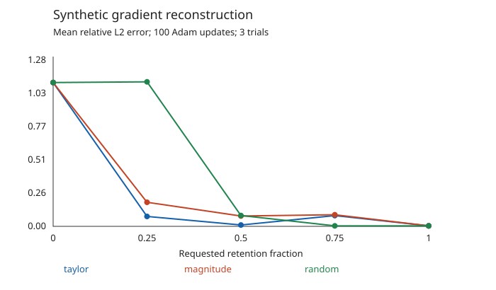

# Synthetic pruning and gradient privacy lab

All inputs are generated from the recorded seed. Budgets count Adam updates, not FLOPs.

## Numerical checks

| Pruning scale | Absolute score error | Remainder bound |
| --- | --- | --- |
| 0.01 | 9.65e-05 | 0.00015945328 |
| 0.1 | 0.00965 | 0.015945328 |
| 0.5 | 0.24125 | 0.39863319 |
| 1 | 0.965 | 1.5945328 |

Wanda single-weight output norm maximum error: 2.22e-16.
Maximum full-gradient analytic reconstruction L2 error: 1.57e-16.

## Reconstruction

Raw results for every trial, retention fraction, strategy and budget are in inversion.csv.

## Scope

Labels are known; unquantized weight and bias gradients come from one synthetic record.
The optimizer sees selected indices and values, but does not enforce top-k selection consistency.
One initialization per trial is shared across all strategies and masks. Results do not establish attack optimality.
At rho=0 no gradient coordinates are observed: the initialization is retained and zero updates are performed.
The empty-observation matching objective is conventionally zero and does not measure reconstruction quality.
Epiplexity, MDL and formal privacy guarantees are not measured.
